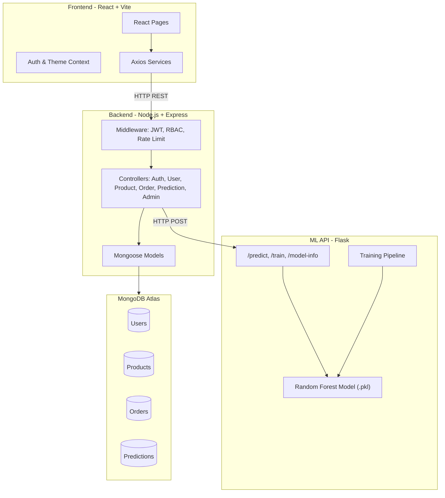
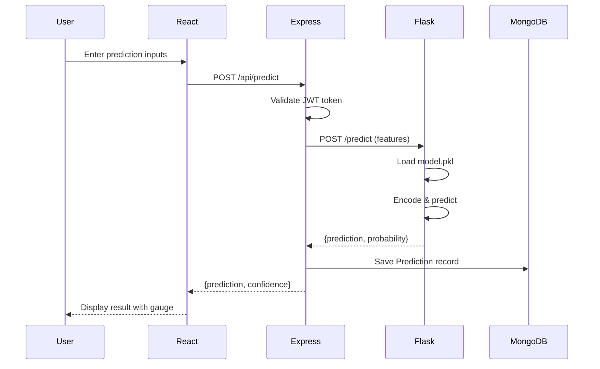
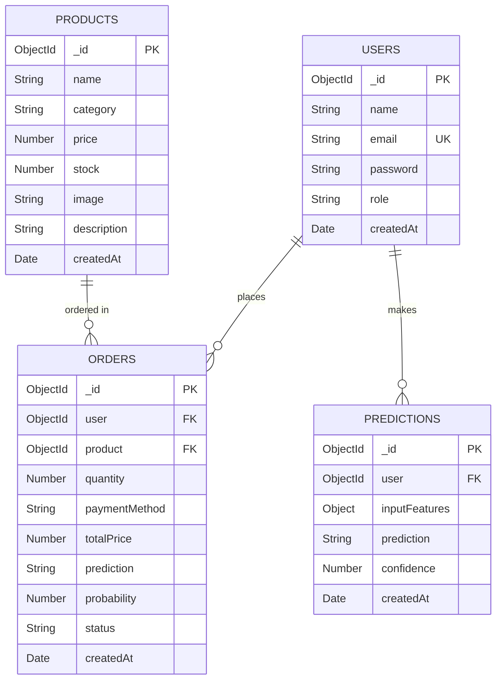
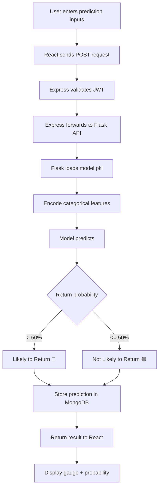

# 🧠 ReturnSense — AI-Based Product Return Prediction for E-Commerce

A full-stack, production-ready web application that uses Machine Learning to predict whether an e-commerce product is likely to be returned. Built with React, Node.js, Flask, and MongoDB.

    

---

## 📋 Table of Contents

- [Architecture](#architecture)
- [Features](#features)
- [Tech Stack](#tech-stack)
- [Project Structure](#project-structure)
- [Database Schema](#database-schema)
- [API Documentation](#api-documentation)
- [ML Model](#ml-model)
- [Prediction Flow](#prediction-flow)
- [Setup & Installation](#setup--installation)
- [Deployment Guide](#deployment-guide)
- [Security](#security)
- [Testing](#testing)

---

## 🏗️ Architecture

```
┌─────────────────┐     ┌─────────────────┐     ┌─────────────────┐
│   React Client  │────▶│  Express Server  │────▶│   Flask ML API  │
│   (Port 5173)   │◀────│   (Port 5000)    │◀────│   (Port 5001)   │
└─────────────────┘     └────────┬─────────┘     └────────┬────────┘
                                 │                        │
                                 ▼                        ▼
                        ┌─────────────────┐     ┌─────────────────┐
                        │  MongoDB Atlas   │     │   model.pkl     │
                        │   (Database)     │     │  (ML Model)     │
                        └─────────────────┘     └─────────────────┘
```

### Architecture Diagram



### Sequence Diagram — Prediction Flow



### ER Diagram



---

## ✨ Features

### User Module
- ✅ Register & Login with JWT Authentication
- ✅ Browse & Search Products
- ✅ View Product Details
- ✅ Place Orders with AI Return Prediction
- ✅ View Order History
- ✅ View Prediction Results with Visual Gauge
- ✅ User Profile Management
- ✅ Dark Mode Support

### Admin Module
- ✅ Admin Dashboard with Analytics
- ✅ Manage Users (CRUD)
- ✅ Manage Products (CRUD)
- ✅ Manage Orders
- ✅ Upload Dataset (CSV)
- ✅ Train ML Model
- ✅ View Prediction History
- ✅ Analytics Charts (Recharts)
- ✅ High Risk Customers Report
- ✅ High Risk Products Report

### ML Module
- ✅ Synthetic Dataset (2000 rows)
- ✅ 4 Algorithms: Logistic Regression, Decision Tree, Random Forest, XGBoost
- ✅ Auto-selects best model by F1-Score
- ✅ Flask REST API for predictions
- ✅ Model retraining endpoint

---

## 🛠️ Tech Stack

| Layer | Technologies |
|-------|-------------|
| Frontend | React 18, Vite, React Router v6, Tailwind CSS, Recharts, React Hook Form |
| Backend | Node.js, Express.js, Mongoose, JWT, bcrypt, Helmet, CORS |
| ML API | Python, Flask, Scikit-learn, XGBoost, Pandas, NumPy, Joblib |
| Database | MongoDB Atlas |
| Deployment | Vercel (Frontend), Render (Backend + ML API) |

---

## 📁 Project Structure

```
AI-Based Product Return Prediction for E-Commerce/
├── client/                          # React Frontend
│   ├── index.html
│   ├── package.json
│   ├── vite.config.js
│   ├── tailwind.config.js
│   ├── postcss.config.js
│   └── src/
│       ├── main.jsx                 # Entry point
│       ├── App.jsx                  # Router setup
│       ├── index.css                # Tailwind imports
│       ├── context/
│       │   ├── AuthContext.jsx      # Authentication state
│       │   └── ThemeContext.jsx     # Dark mode state
│       ├── hooks/
│       │   ├── useAuth.js
│       │   └── useTheme.js
│       ├── services/
│       │   ├── api.js               # Axios instance
│       │   ├── authService.js
│       │   ├── productService.js
│       │   ├── orderService.js
│       │   ├── predictionService.js
│       │   └── adminService.js
│       ├── components/
│       │   ├── Navbar.jsx
│       │   ├── Sidebar.jsx
│       │   ├── Footer.jsx
│       │   ├── ProtectedRoute.jsx
│       │   ├── LoadingSpinner.jsx
│       │   ├── ProductCard.jsx
│       │   ├── StatsCard.jsx
│       │   ├── PredictionGauge.jsx
│       │   ├── DataTable.jsx
│       │   ├── SearchBar.jsx
│       │   └── HeroSection.jsx
│       ├── layouts/
│       │   ├── MainLayout.jsx
│       │   └── AdminLayout.jsx
│       └── pages/
│           ├── LandingPage.jsx
│           ├── LoginPage.jsx
│           ├── RegisterPage.jsx
│           ├── DashboardPage.jsx
│           ├── ProductsPage.jsx
│           ├── ProductDetailPage.jsx
│           ├── OrderPage.jsx
│           ├── PredictionResultPage.jsx
│           ├── OrderHistoryPage.jsx
│           ├── ProfilePage.jsx
│           ├── NotFoundPage.jsx
│           └── admin/
│               ├── AdminDashboardPage.jsx
│               ├── ManageProductsPage.jsx
│               ├── ManageUsersPage.jsx
│               ├── ManageOrdersPage.jsx
│               ├── AnalyticsPage.jsx
│               ├── PredictionReportsPage.jsx
│               └── HighRiskPage.jsx
│
├── server/                          # Node.js Backend
│   ├── package.json
│   ├── server.js                    # Express app entry
│   ├── seed.js                      # Database seeder
│   ├── .env.example
│   ├── config/
│   │   └── db.js                    # MongoDB connection
│   ├── models/
│   │   ├── User.js
│   │   ├── Product.js
│   │   ├── Order.js
│   │   └── Prediction.js
│   ├── middleware/
│   │   ├── auth.js                  # JWT verification
│   │   ├── admin.js                 # Role-based access
│   │   ├── errorHandler.js
│   │   └── validate.js
│   ├── controllers/
│   │   ├── authController.js
│   │   ├── userController.js
│   │   ├── productController.js
│   │   ├── orderController.js
│   │   ├── predictionController.js
│   │   └── adminController.js
│   └── routes/
│       ├── authRoutes.js
│       ├── userRoutes.js
│       ├── productRoutes.js
│       ├── orderRoutes.js
│       ├── predictionRoutes.js
│       └── adminRoutes.js
│
├── ml-model/                        # Python ML API
│   ├── requirements.txt
│   ├── app.py                       # Flask REST API
│   ├── train_model.py               # Training pipeline
│   ├── predict.py                   # Prediction module
│   ├── generate_dataset.py          # Synthetic data generator
│   ├── dataset.csv                  # Training data (2000 rows)
│   ├── model.pkl                    # Trained model
│   ├── label_encoders.pkl           # Feature encoders
│   └── model_info.json              # Model metadata
│
├── .gitignore
└── README.md
```

---

## 🗄️ Database Schema

### Users Collection
| Field | Type | Description |
|-------|------|-------------|
| name | String | User's full name |
| email | String | Unique email address |
| password | String | Bcrypt hashed password |
| role | String | 'user' or 'admin' |
| createdAt | Date | Registration timestamp |

### Products Collection
| Field | Type | Description |
|-------|------|-------------|
| name | String | Product name |
| category | String | Electronics, Clothing, Shoes, Home & Kitchen, Beauty, Sports, Books |
| price | Number | Product price |
| stock | Number | Available stock |
| image | String | Image URL |
| description | String | Product description |

### Orders Collection
| Field | Type | Description |
|-------|------|-------------|
| user | ObjectId | Reference to User |
| product | ObjectId | Reference to Product |
| quantity | Number | Order quantity |
| paymentMethod | String | Credit Card, Debit Card, UPI, COD, Net Banking |
| totalPrice | Number | Calculated total |
| prediction | String | ML prediction result |
| probability | Number | Return probability (%) |
| status | String | Pending, Confirmed, Shipped, Delivered, Returned |

### Predictions Collection
| Field | Type | Description |
|-------|------|-------------|
| user | ObjectId | Reference to User |
| inputFeatures | Object | All ML input features |
| prediction | String | Likely to Return / Not Likely to Return |
| confidence | Number | Confidence percentage |

---

## 📡 API Documentation

### Authentication
| Method | Endpoint | Description | Auth |
|--------|----------|-------------|------|
| POST | `/api/auth/register` | Register new user | ❌ |
| POST | `/api/auth/login` | Login user | ❌ |
| GET | `/api/auth/me` | Get current user | ✅ |

### Users
| Method | Endpoint | Description | Auth |
|--------|----------|-------------|------|
| GET | `/api/users/profile` | Get user profile | ✅ |
| PUT | `/api/users/profile` | Update profile | ✅ |
| GET | `/api/users` | Get all users | 🔒 Admin |
| DELETE | `/api/users/:id` | Delete user | 🔒 Admin |

### Products
| Method | Endpoint | Description | Auth |
|--------|----------|-------------|------|
| GET | `/api/products` | Get all products | ❌ |
| GET | `/api/products/:id` | Get product by ID | ❌ |
| POST | `/api/products` | Create product | 🔒 Admin |
| PUT | `/api/products/:id` | Update product | 🔒 Admin |
| DELETE | `/api/products/:id` | Delete product | 🔒 Admin |

### Cart & Wishlist
| Method | Endpoint | Description | Auth |
|--------|----------|-------------|------|
| GET | `/api/cart` | Get current user's cart | ✅ |
| POST | `/api/cart/items` | Add item to cart | ✅ |
| PUT | `/api/cart/items/:itemId` | Update quantity | ✅ |
| DELETE | `/api/cart/items/:itemId` | Remove item | ✅ |
| PUT | `/api/cart/items/:itemId/save-for-later` | Toggle saved-for-later | ✅ |
| GET | `/api/wishlist` | Get user's wishlist | ✅ |
| POST | `/api/wishlist/:productId` | Add product to wishlist | ✅ |
| DELETE | `/api/wishlist/:productId` | Remove product from wishlist | ✅ |
| GET | `/api/wishlist/check?productId=` | Check if product is in wishlist | ✅ |

### Reviews & Ratings
| Method | Endpoint | Description | Auth |
|--------|----------|-------------|------|
| GET | `/api/reviews/product/:productId` | Get product reviews & average rating | ❌ |
| POST | `/api/reviews/product/:productId` | Submit review (1 per customer) | ✅ |
| GET | `/api/reviews/my` | Get current customer's reviews | ✅ |
| DELETE | `/api/reviews/:id` | Delete review (owner or admin) | ✅ |

### Orders & Invoices
| Method | Endpoint | Description | Auth |
|--------|----------|-------------|------|
| POST | `/api/orders` | Create order with automated ML prediction | ✅ |
| GET | `/api/orders` | Get user's order history | ✅ |
| GET | `/api/orders/:id` | Get order detail (ownership enforced) | ✅ |
| GET | `/api/orders/:id/invoice` | Generate printable order invoice | ✅ |
| POST | `/api/orders/:id/cancel` | Request order cancellation & restock | ✅ |
| POST | `/api/orders/:id/return` | Request order return with reasons | ✅ |
| GET | `/api/orders/all` | Get all orders | 🔒 Admin |
| PUT | `/api/orders/:id/status` | Update status (all 13 enum transitions) | 🔒 Admin |

### Predictions
| Method | Endpoint | Description | Auth |
|--------|----------|-------------|------|
| POST | `/api/predict` | Make return prediction | ✅ |
| GET | `/api/predict` | Get user's prediction history | ✅ |
| GET | `/api/predict/all` | Get all predictions | 🔒 Admin |
| GET | `/api/predict/analytics` | Prediction analytics | 🔒 Admin |

### Admin & Business Analytics
| Method | Endpoint | Description | Auth |
|--------|----------|-------------|------|
| GET | `/api/admin/dashboard` | Real database KPIs (Revenue, Return Rates) | 🔒 Admin |
| GET | `/api/admin/analytics` | Revenue and order monthly trends | 🔒 Admin |
| GET | `/api/admin/customer-analytics` | Customer CLV & frequent-return analytics | 🔒 Admin |
| GET | `/api/admin/inventory` | Inventory valuation & stock health | 🔒 Admin |
| GET | `/api/admin/reports` | 6 report types (Product, Customer, Sales, etc.) | 🔒 Admin |
| GET | `/api/admin/export-csv` | Stream filtered reports as CSV | 🔒 Admin |
| GET | `/api/admin/model-info` | Real ML model evaluation metrics & features | 🔒 Admin |
| GET | `/api/admin/high-risk-customers` | High return risk customers | 🔒 Admin |
| GET | `/api/admin/high-risk-products` | High return risk products | 🔒 Admin |
| POST | `/api/admin/upload-dataset` | Upload CSV dataset for training | 🔒 Admin |

### Flask ML API (Port 5001)
| Method | Endpoint | Description |
|--------|----------|-------------|
| POST | `/predict` | Predict return probability |
| POST | `/train` | Retrain model |
| GET | `/model-info` | Get model metadata |
| GET | `/health` | Health check |

---

## 🤖 ML Model

### Dataset Features
| Feature | Type | Range |
|---------|------|-------|
| Customer_Age | Numeric | 18-70 |
| Gender | Categorical | Male, Female |
| Product_Category | Categorical | 7 categories |
| Product_Price | Numeric | 5-500 |
| Discount | Numeric | 0-50% |
| Quantity | Numeric | 1-10 |
| Payment_Method | Categorical | 5 methods |
| Delivery_Time | Numeric | 1-15 days |
| Shipping_Distance | Numeric | 5-500 km |
| Previous_Returns | Numeric | 0-10 |
| Customer_Rating | Numeric | 1-5 |
| Order_Frequency | Numeric | 1-50 |
| **Return_Status** | **Target** | **0 or 1** |

### Model Performance (Measured Evaluation)
| Algorithm | Accuracy | Precision | Recall | F1-Score | Status |
|-----------|----------|-----------|--------|----------|--------|
| Logistic Regression | 68.25% | 69.41% | 85.38% | 76.55% | Baseline |
| Decision Tree | 66.50% | 71.74% | 76.15% | 73.88% | Baseline |
| **Random Forest (Tuned)** | **70.50%** | **72.19%** | **88.85%** | **79.66%** | **Selected Best Model** |
| Gradient Boosting | 69.25% | 71.13% | 85.00% | 77.44% | Evaluated |

> Best model: **Random Forest (Tuned)** (Auto-selected by highest F1-Score: 0.7966 via RandomizedSearchCV on validation split)

---

## 🔄 Prediction Flow



---

## 🚀 Setup & Installation

### Prerequisites
- Node.js >= 18
- Python >= 3.9
- MongoDB Atlas account
- Git

### 1. Clone the Repository
```bash
git clone https://github.com/your-username/ai-product-return-prediction.git
cd ai-product-return-prediction
```

### 2. Setup ML Model
```bash
cd ml-model
pip install -r requirements.txt
python generate_dataset.py    # Generate synthetic dataset
python train_model.py          # Train model (saves model.pkl)
python app.py                  # Start Flask API on port 5001
```

### 3. Setup Backend
```bash
cd server
npm install
cp .env.example .env           # Edit with your MongoDB URI and JWT secret
node seed.js                   # Seed database with sample data
npm run dev                    # Start Express server on port 5000
```

### 4. Setup Frontend
```bash
cd client
npm install
npm run dev                    # Start Vite dev server on port 5173
```

### 5. Access the Application
- Frontend: http://localhost:5173
- Backend API: http://localhost:5000
- Flask ML API: http://localhost:5001

### Default Credentials
| Role | Email | Password | Access Scope |
|------|-------|----------|--------------|
| Admin | admin@returnsense.com | admin123 | Full administrative portal access |
| Admin (Alt) | admin@example.com | admin123 | Administrative portal access |
| Customer | alice@example.com | password123 | Full shopping, orders, wishlist, reviews |
| Customer | john@example.com | password123 | Full shopping, orders, wishlist, reviews |

---

## 🌐 Deployment Guide

### Frontend → Vercel
1. Push code to GitHub
2. Connect repo to Vercel
3. Set build command: `cd client && npm install && npm run build`
4. Set output directory: `client/dist`
5. Add environment variable: `VITE_API_URL=https://your-backend.onrender.com`

### Backend → Render
1. Create new Web Service on Render
2. Set root directory: `server`
3. Build command: `npm install`
4. Start command: `node server.js`
5. Add environment variables: `MONGO_URI`, `JWT_SECRET`, `ML_API_URL`, `NODE_ENV=production`

### ML API → Render
1. Create new Web Service on Render
2. Set root directory: `ml-model`
3. Build command: `pip install -r requirements.txt`
4. Start command: `gunicorn app:app --bind 0.0.0.0:$PORT`

### Database → MongoDB Atlas
1. Create free M0 cluster at mongodb.com
2. Create database user
3. Whitelist IP addresses (0.0.0.0/0 for Render)
4. Get connection string and set as `MONGO_URI`

---

## 🔒 Security

- ✅ **JWT Authentication** — 24-hour token expiry with secure HTTP authorization
- ✅ **Password Hashing** — bcrypt with 10 salt rounds and pre-save model hooks
- ✅ **Role-Based Access Control** — Strict User and Admin role isolation (`403 Forbidden` on non-admin)
- ✅ **Data Ownership Checks** — Customers can only access/cancel/generate invoices for their own orders
- ✅ **Server-Side Price Validation** — Product prices and discounts recalculate strictly from database
- ✅ **Helmet & CORS** — Production security headers and whitelisted frontend origins
- ✅ **Rate Limiting** — express-rate-limit protecting auth and general API routes
- ✅ **Stock Consistency** — Order placement decrements stock; order cancellation automatically restocks

---

## 🧪 Testing

### Automated Comprehensive System Verification (45 Assertions)
Run the full-stack integration test suite covering Flask ML, Auth, Catalog, Cart/Wishlist, Orders, Invoices, Reviews, and Admin Analytics/CSV export:
```bash
node scripts/test_complete_suite.js
```
Expected output:
```
====================================================
ReturnSense: Comprehensive System Verification Suite
====================================================
[1/7] Testing ML Service (Flask API directly)... [5/5 PASS]
[2/7] Testing Authentication, Profile & Address Management... [7/7 PASS]
[3/7] Testing Product Catalog, Search & Filtering... [5/5 PASS]
[4/7] Testing Cart & Wishlist Operations... [7/7 PASS]
[5/7] Testing Order Placement & AI Return Prediction Pipeline... [8/8 PASS]
[6/7] Testing Product Reviews & Aggregate Rating Updates... [4/4 PASS]
[7/7] Testing Admin Analytics, Reports, Inventory & CSV Export... [9/9 PASS]

====================================================
Test Execution Results: 45 PASSED, 0 FAILED
====================================================
```

### Manual Endpoint Testing
```bash
# Health checks
curl http://localhost:5001/health
curl http://localhost:5000/api/health

# ML Model Prediction
curl -X POST http://localhost:5001/predict \
  -H "Content-Type: application/json" \
  -d '{"Customer_Age":25,"Gender":"Male","Product_Category":"Clothing","Product_Price":150,"Discount":35,"Quantity":2,"Payment_Method":"Cash on Delivery","Delivery_Time":10,"Shipping_Distance":350,"Previous_Returns":5,"Customer_Rating":2,"Order_Frequency":3}'

# Admin Login
curl -X POST http://localhost:5000/api/auth/login \
  -H "Content-Type: application/json" \
  -d '{"email":"admin@returnsense.com","password":"admin123"}'
```
```

---

## 📄 License

This project is for academic/educational purposes.

---

Built with ❤️ using React, Node.js, Flask, and Machine Learning
